# Лабораторная работа №6

## Содержание отчёта
1. [Цель работы](#Цель-работы)
2. [Порядок выполнения лабораторной работы](#Порядок-выполнения-лабораторной-работы)
3. [Ход выполнения работы](#Ход-выполнения-работы)
4. [Лог команд](#Лог-команд)
5. [История операций в отформатированном виде](#История-операций-в-отформатированном-виде)
6. [Вывод](#Вывод)

## Цель работы 
Изучение базовых возможностей системы управления версиями, опыт работы с Git Api, опыт работы с локальным и удаленным репозиторием.

## Порядок выполнения работы
1. Создать аккаунт на сайте GitHub.
2. Сделать копию в личное хранилище из
https://github.com/Kurtyanik/LR6/ (Fork).
3. Установить Git (https://git-scm.com/).
4. После установки настроить клиент git, введя имя пользователя (Группа
Фамилия И.О.) и email.
5. Клонировать свой личный удалённый репозиторий на компьютер.
6. Добавить файл через интерфейс GitHub. Подтянуть изменения в
локальный репозиторий. 
7. Получить историю операций для каждой из веток.
8. Просмотреть последние изменения.
9. Выполнить слияние в ветку master, разрешив конфликт (можно
использовать специальные редакторы или графический интерфейс git).
10. Удалить побочную ветку после успешного слияния.
11. Сделать изменения и зафиксировать их, оставляя комментарии,
несколько раз.
12. Сделать откат коммита.
13. Создать ветку для отчёта. 
14. Начать оформлять отчёт в файле README.md (разрешены сторонние
редакторы с подсветкой синтаксиса), используя markdown синтаксис
(https://guides.github.com/features/mastering-markdown/):
 В отчёте должен быть снимки экрана консоли и сторонних программ.
Файлы снимков экрана разместить в отдельной папке.
 Лог команд (без результатов их выполнения).
При написании отчёта периодически делать коммиты, не забывать
комментировать.
15. Получить историю операций в форматированном виде (сокращённый
хэш + дата + имя автора + комментарий). Добавить её в отчёт и сделать
финальную фиксацию изменений.
16. Отправить локальные изменения в сетевое хранилище GitHub (если
делаете работу постепенно, то синхронизацию проводить в конце рабочего
сеанса) 

## Ход выполнения работы
### 1. Создание аккаунта на GitHub
Для создания аккаунта на сайте GitHub, необходимо перейти на страницу: https://github.com/signup - и заполнить форму регистрации (рис. 1).

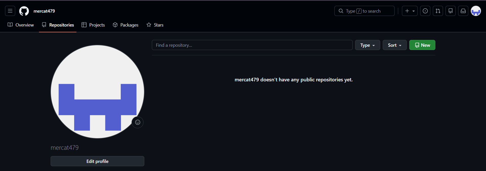

  Рисунок 1 - Создание аккаунта

### 2. Создание копии в личном хранилище из https://github.com/Kurtyanik/LR6/ (Fork).
Далее, создавалась копия репозитория. Для этого нужно перейти на репозиторий преподавателя, указать параметры (рис. 2) и создать копию (рис. 3)
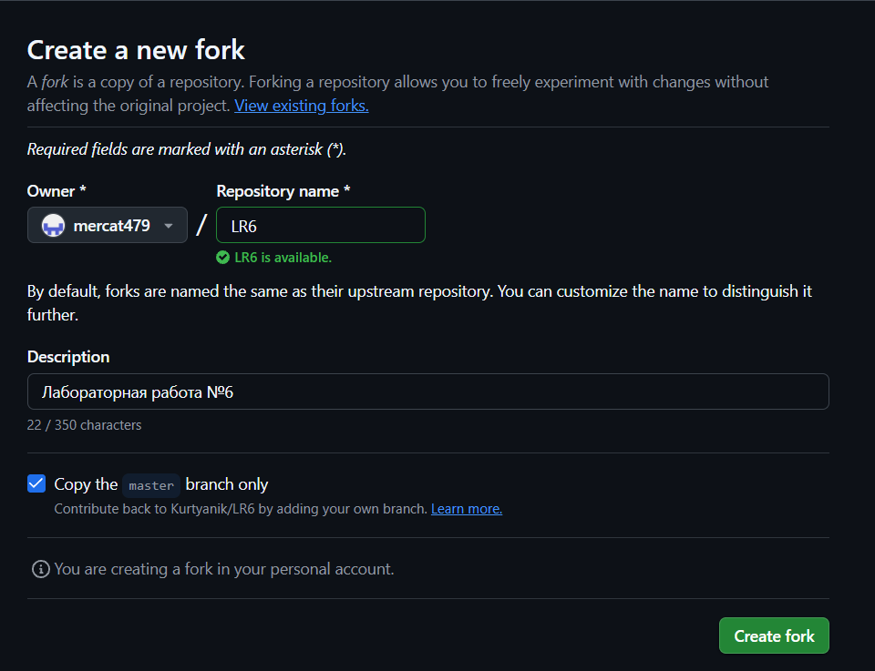

  Рисунок 2 - Параметры

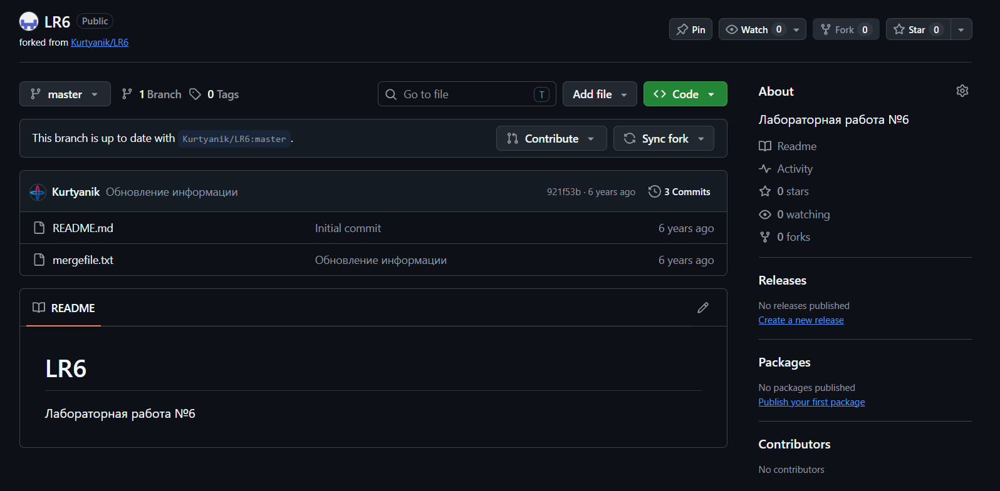

  Рисунок 3 - Создание копии

### 3. Установка Git
Чтобы установить Git, необходимо перейти на страницу https://git-scm.com (рис. 4) и скачать её

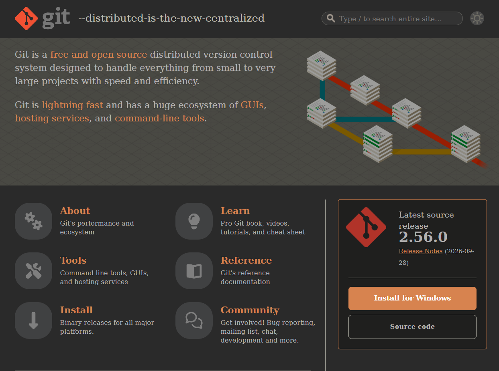

  Рисунок 4 - Установка Git

### 4. Настройка клиента Git
Чтобы указать имя пользователя и email в клиенте Git, необходимо воспользоваться соответствующими командами:

git config --global user.name "(username)"

git config --global user.email "(email)"

Настройка клиента Git представлена на рисунке 5.
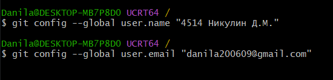

  Рисунок 5 - Настройка клиента Git

### 5. Клонирование удалённого репозитория на компьютер
Для клонирования своего личного удалённого репозитория на компьютер сначала нужно перейти в папку, где должен храниться репозиторий. Это осуществляется с помощью команды:

cd (путь)

Затем, можно клонировать удалённый репозиторий на свой компьютер (рис. 6) с помощью следующей команды:

git clone (ссылка на удалённый репозиторий)

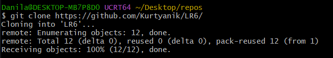

  Рисунок 6 - Клонирование удалённого репозитория

### 6. Добавление файла через интерфейс GitHub. Подтягивание изменений в локальный репозиторий
Чтобы добавить файл через интерфейс GitHub, нужно нажать на кнопку "Add file", а затем перейти в "Create new file" (рис. 7).
Далее необходимо написать название файла и его содержимое (рис. 8).
После подтверждения изменений, созданный файл появится в репозитории(рис. 9).
Чтобы установить изменения в локальном репозитории, необходимо в него перейти и воспользоваться командой:

git pull

Чтобы просмотреть файлы в локальном репозитории, необходимо ввести команду:

ls -1

На рисунке 10 представлены файлы репозитория до и после добавления 'new_file'.

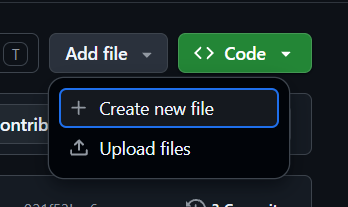

  Рисунок 7 - Создание файла

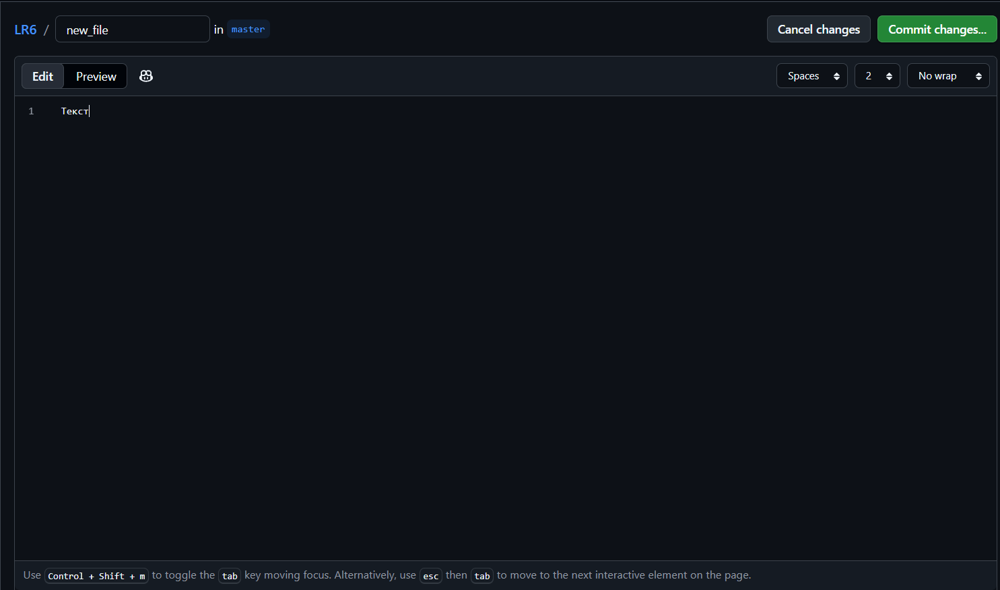

  Рисунок 8 - Добавление текста

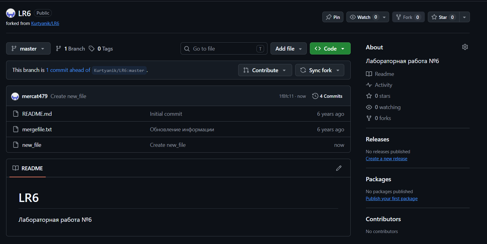

  Рисунок 9 - Файл в репозиторие 

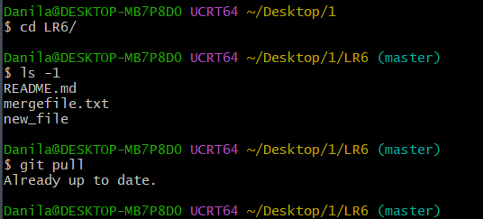

  Рисунок 10 - Проверка 

### 7. Получение истории операций для каждой из веток
Чтобы получить историю операций для каждой ветки, необходимо на каждой ветки выполнить команду:

git log (Название ветки)

Так, при выполнении команды 

git log master

в консоль выводится история операция для ветки master (рис. 11).
Чтобы перейти на другую ветку можно воспользоваться командой:

git checkout (название ветки)

После перехода на ветку branch1 необходимо выполнить команду 

git log branch1,

чтобы получить историю операций данной ветки (рис. 12).

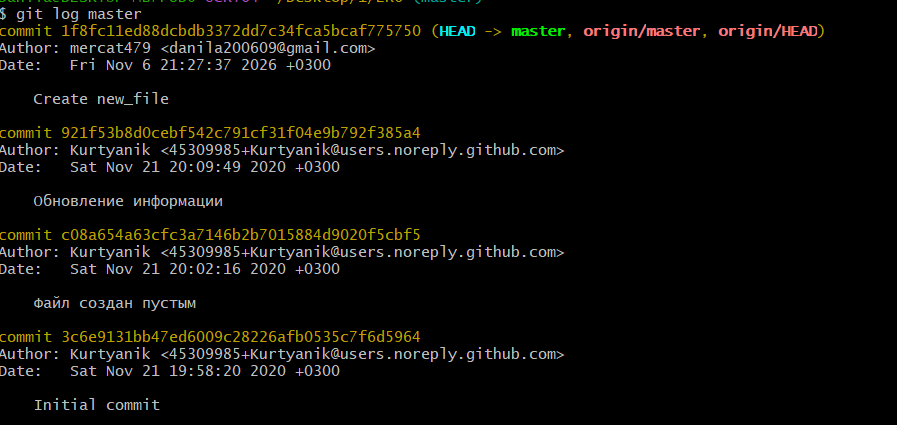

  Рисунок 11 - История операций ветки master

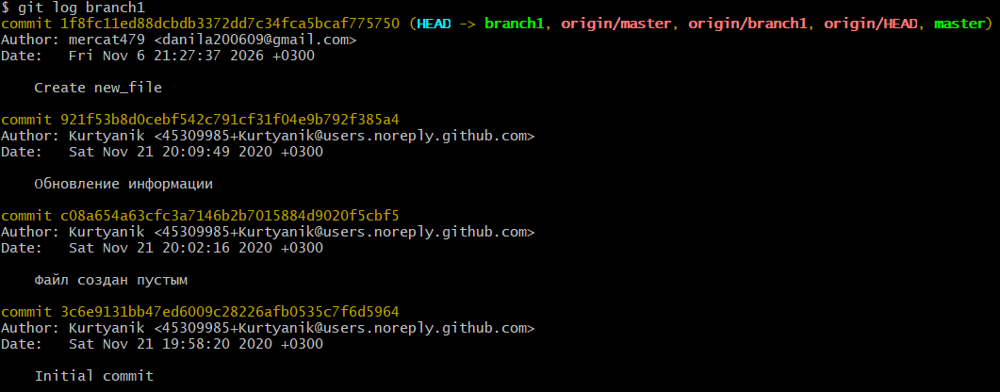

  Рисунок 12 - История операций ветки branch1

### 8. Просмотр последних изменений.
Чтобы просмотреть последние изменения, нужно на каждой ветке выполнить команду:

git show (Название ветки)

Так, находясь на ветке branch1, можно выполнять команду 

git show branch1.

В результате получим последние изменения на ветке branch1 (рис. 13).
Затем необходимо выполнить команду 

git show master,

при этом находясь на ветке master, чтобы получить последние изменения ветки master (рис. 14).

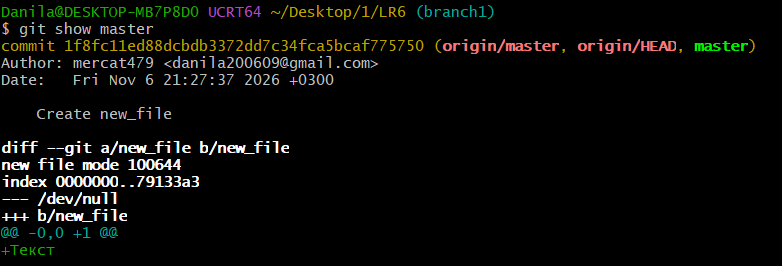

  Рисунок 14 - Последние изменения 

### 9. Выполнение слияния в ветку master, разрешив конфликт
Чтобы слить две ветки нужно перейти на ветку в которую нужно слить файлы со второй ветки и воспользоваться командой:

git merge (Название второй ветки)

При попытке слить в ветку master ветку branch1 возникает конфликт (рис. 15).
Чтобы посмотреть в консоли подробности конфликта (рис. 16), можно воспользоваться командой:

git diff

Чтобы разрешить конфликт можно использовать специальные редакторы или графический интерфейс git. Для разрешения данного конфликта был использован редактор Блокнот (рис. 17).
После того как конфликт разрешён, полученный файл необходимо зафиксировать. Для этого сначала добавляем его в индекс с помощью команды:

git add (Название файла)

Затем проверям, что он добавился в индекс:

git status

И последним шагом фиксируем изменения, чтобы завершить слияние (рис. 18) с помощью команды:

git commit -m "(Комментарий)"

Чтобы передать все изменения в ветке master в удалённый репозиторий, необходимо воспользоватсья командой:

git push

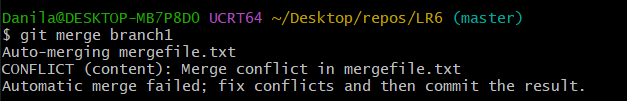

  Рисунок 15 - Конфликт

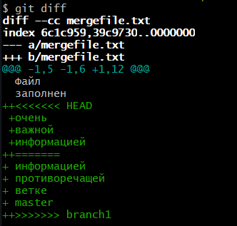

  Рисунок 16 - Подробности конфликта

  Рисунок 17 - Разрешение конфликта

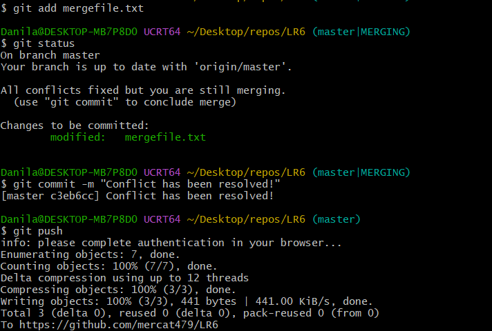

  Рисунок 18 - Слияние

### 10. Удаление побочной ветки
После успешного слияния ветка branch1 больше не нужна и её нужно удалить (рис. 19).

Сначала её нужно удалить локально с помощью команды:

git branch -d (Название ветки)

Затем её нужно удалить из удалённого репозитория:

git push origin --delete branch1

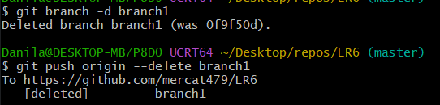

  Рисунок 19 - Удаление побочной ветки

### 11. Создание изменений и их фиксация (с комментариями)
Чтобы создать текстовый файл или сделать изменения в уже существующем файле можно воспользоваться командой:

echo "Новый текст файла" > (Название файла).txt

Были созданы файлы file2.txt и file3.txt. Оба раза изменения репозитория фиксировались с комментариями (рис. 20 - 21)

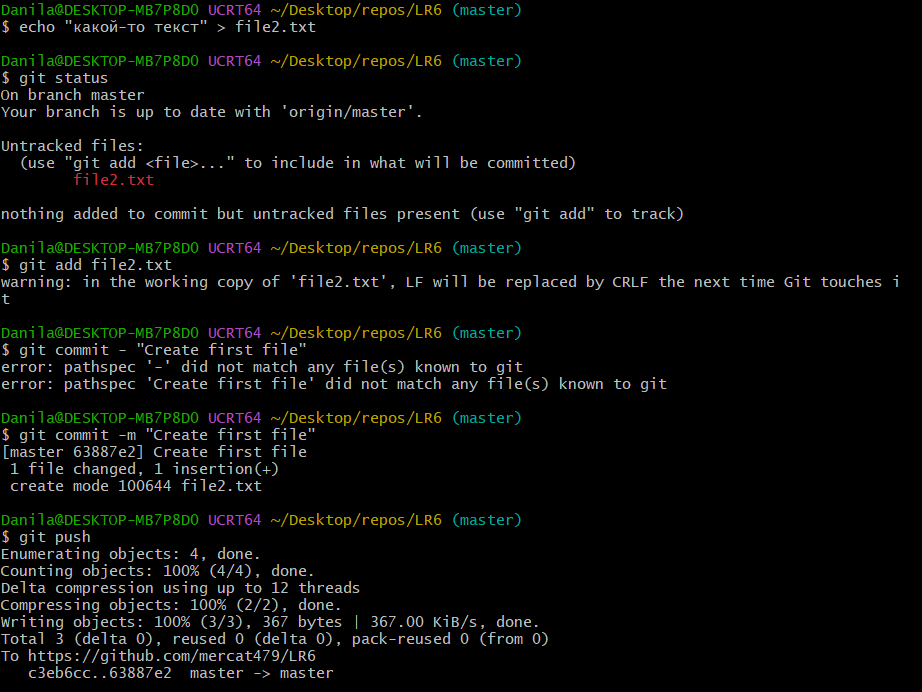

  Рисунок 20 - Первый файл

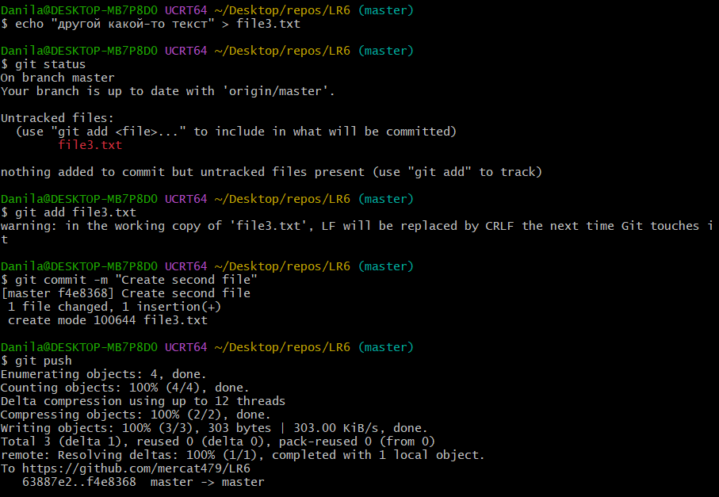

  Рисунок 21 - Второй файл

### 12. Создание отката коммита
Перед откатом коммита необходимо проверить их историю (рис. 22), чтобы после отката можно было убедиться, что всё прошло успешно. Проверить историю можно с помощью команды:

git log

Для откада последнего коммита необходимо воспользоваться командой:

git reset HEAD~1

После отката последнего коммита ещё раз была использвана команда git log. До отката последний коммит был "Create second file", а после стал "Create first file", значит откат прошёл успешно (рис. 23).

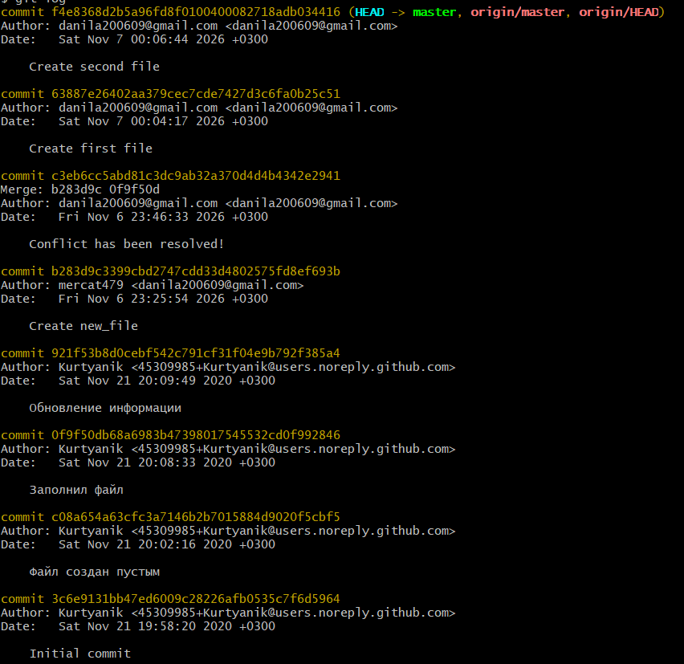

  Рисунок 22 - Проверка истории

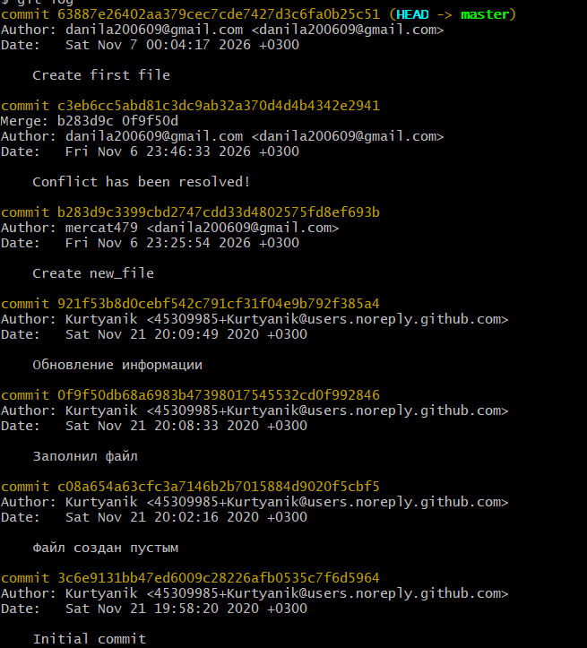

  Рисунок 23 - Откат

### 13. Создание ветки для отчёта(Report)
Для создания ветки для отчёта (рис. 24) необходимо воспользоваться командой:

git branch (Название новой ветки)

А чтобы посмотреть какие существуют ветки, можно воспользоватсья командой:

git branch

Чтобы недавно созданная локальная ветка report появилась в удалённом репозитории, нужно воспользоваться командой:

git push origin Report

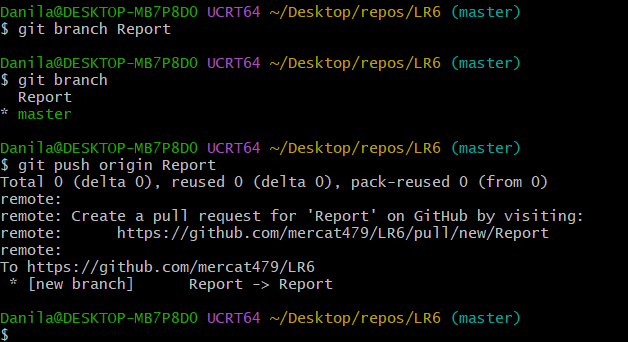

  Рисунок 24 - Откат

### 14. Начало оформления отчёта в файле README.md
Ещё одним важным требованием для выполнения лабораторной работы является написание отчёта в файле README.md. Для удобного форматирования этого файла был выбран редактор кода VS (рис. 25)

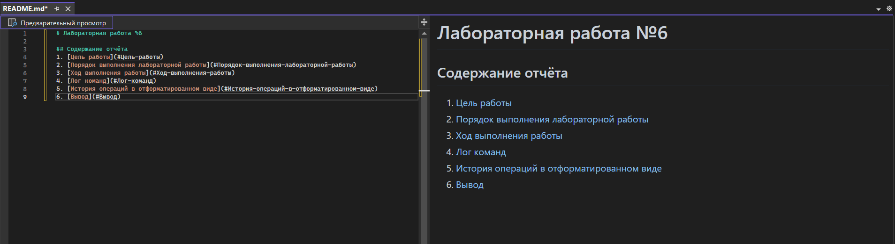

  Рисунок 25 - Откат

### 15. Получить историю операций в форматированном виде
Чтобы получить историю операций в форматированном виде (рис. 28) (сокращённый хэш + дата + имя автора + комментарий), необходимо воспользоваться командой:

git log --date=format:'%D' --pretty=format:"%h -> %cd, %cn ( %s )"

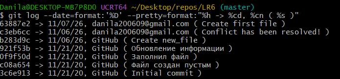

  Рисунок 26 - История операций в форматированном виде

### 16. Отправить локальные изменения в сетевое хранилище GitHub

Чтобы отправить локальные изменения в сетевое хранилище GitHub после завершения написания отчёта нужно воспользоваться командой:

git push

После чего все локальные изменения ветки Report появятся в удалённом репозитории

## Лог файлов
git config --global user.name "(username)"

git config --global user.email "(email)"

cd (путь)

git clone (ссылка на удалённый репозиторий)

git pull

ls -1 

git log (Название ветки)

git log master

git checkout (название ветки)

git show branch1

git show master

git merge (Название второй ветки)

git diff

git add (Название файла)

git status

git commit -m "(Комментарий)"

git push

git branch -d (Название ветки)

git push origin --delete branch1

echo "Новый текст файла" > (Название файла).txt

git reset HEAD~1

git push origin Report

## История операций в отформатированном виде
$ git log --date=format:'%D' --pretty=format:"%h -> %cd, %cn ( %s )"
63887e2 -> 11/07/26, danila200609@gmail.com ( Create first file )
c3eb6cc -> 11/06/26, danila200609@gmail.com ( Conflict has been resolved! )
b283d9c -> 11/06/26, GitHub ( Create new_file )
921f53b -> 11/21/20, GitHub ( Обновление информации )
0f9f50d -> 11/21/20, GitHub ( Заполнил файл )
c08a654 -> 11/21/20, GitHub ( Файл создан пустым )
3c6e913 -> 11/21/20, GitHub ( Initial commit )

## Вывод
В ходе данной лабораторной работы были изучены базовые возможности системы управления версиями, а также получен опыт работы с Git Api и опыт работы с локальным и удаленным репозиторием.
